<p align="center">
  
</p>

<h1 align="center">Liar's Bar: Fully Loaded</h1>

<p align="center"><b>8 Players, Matchmaking and More</b></p>

<p align="center">
  <a href="../../releases/latest"></a>
  
  
  
  
</p>

> **Unofficial.** A fan-made mod, not affiliated with or endorsed by Curve Animation, the makers
> of Liar's Bar. You need your own copy of the game.

> **Written by an AI.** Every line of this mod was produced by Claude, directed by one person, as
> a for-fun experiment. Nothing about playing a match shipped on the strength of "it should work",
> and what has not been tried yet is listed under [What still is not true](#what-still-is-not-true).

**It started as the 8 Player Mod, and it is now an overhaul.** Four chairs became eight in every
mode, and around that table there is now a way to find strangers who have the mod, bots for the
empty seats, house rules, awards at the end of a match, cameras for players who are out, a block
list, two tables the game carries but never put on a menu, full-width ultrawide screens, fair
play checks, and the mod's words in four languages.

Built with [BepInEx 6 (IL2CPP)](https://github.com/BepInEx/BepInEx) and Harmony. **No game files
are modified on disk**: everything is patched at runtime, and the uninstaller takes the mod out of
the game folder. It leaves your block list and saved screen size in `%LOCALAPPDATA%\LiarsBar8P`
(see [Uninstall](#uninstall)).

**Everyone playing together must install this, on the same version.** The version you are running
is drawn at the top of the screen in game, beside the **FULLY LOADED** tag. A table won't start
until everyone seated at it runs the host's version, and the mod won't let you join a table on
another version. Players without the mod are turned away by the host, because they would desync
the table.

**Ranked is off while Fully Loaded is on.** The ranked button says so and opens the lobby list
instead. To play ranked, or the base game, click **FULLY LOADED: ON** at the bottom of the main
menu twice: the game restarts with the mod off, exactly like the base game, and only that button
left to turn it back on. To remove the mod, [uninstall](#uninstall) it.

---

- [What's in it](#whats-in-it)
- [Install](#install) and [updating](#updating)
- [Linux and Steam Deck](#linux-and-steam-deck)
- [Settings](#settings)
- [What still is not true](#what-still-is-not-true)
- [Something went wrong? Save a bug report](#something-went-wrong-save-a-bug-report)
- [Uninstall](#uninstall), [building from source](#building-from-source), [licence](#licence)

---

## What's in it

### Eight at the table

Every mode seats up to eight: Liar's Deck (Basic, Devil and Deck 2), the Chaos deck, Liar's Dice
(Basic and Traditional), Liar's Poker, Liar's Slots and Two-Card Poker. The chairs are spaced
evenly round whatever table the bar has, everyone is dealt, the turn goes round every seat, and in
the Chaos deck the revolver can be aimed at any other player, with the name of the one you are
aiming at shown while you choose. The lobby gets a second row of podiums, with every name plate
above the player it belongs to, and the emote keys reach every seat.

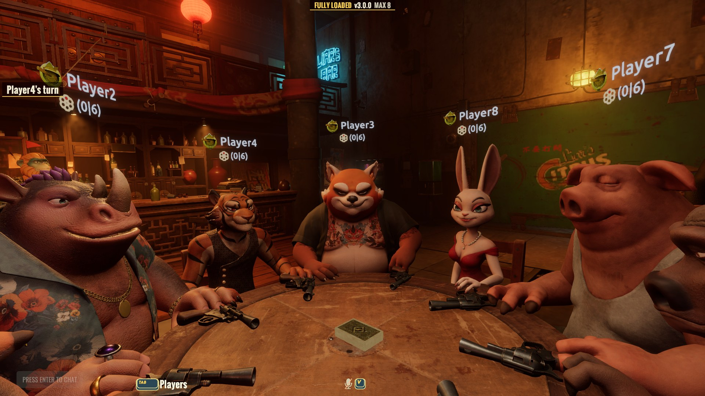

*Liar's Deck at eight, from one of the chairs.*

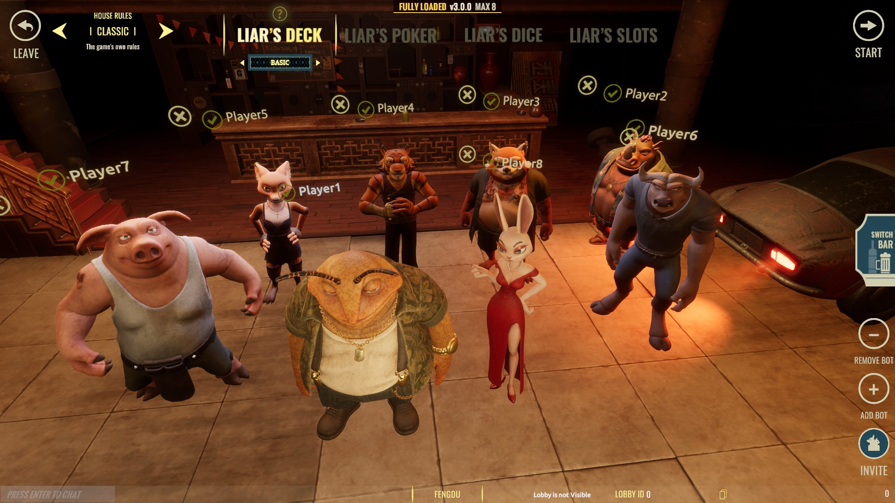

*The lobby at eight: a second row of podiums, a name plate above each player, and eight different characters.*

### Finding a game

You don't need seven friends. Everyone with the mod shares a pool of lobbies, on Steam, in the
game's own menus. There is no server and nothing to sign up for.

- **ENTER THE BAR, then LOBBY LIST** shows lobbies hosted with the mod, from anywhere in the
  world. Each row is marked **FULLY LOADED** and shows how many are in it, like `5/8`, and any
  house rules it plays. A lobby stays listed all the way to full, leaves the list while its match
  runs and comes back after, and one whose host has gone drops off within five minutes.
- **QUICK JOIN** puts you in the fullest lobby with a seat; when two are equally full it picks the
  one playing CLASSIC rules. If nobody is hosting it opens a public lobby for you, and for its first
  45 seconds that lobby keeps looking, so two people pressing it at the same moment end up together.
  The mode boxes count: with only DICE ticked it only joins Liar's Dice lobbies.
- **HOST GAME** works as it always has. A **Public** lobby is found by everybody with the mod, and a
  **Friends Only** lobby stays unlisted.
- **The main menu says how many FULLY LOADED lobbies are open**, and how many players are waiting in
  them, beside ENTER THE BAR.
- A lobby on another version is still listed, marked with the version it runs, and JOIN tells you
  what it needs instead of letting you in. Quick Join skips those.
- A friend without the mod who arrives by invite is told the table needs it, and is sent back to
  the menu a few seconds later. Start stays unlit until that is settled.
- **The copy icon beside LOBBY ID copies the ID every time**, and **JOIN WITH ID says what is wrong**
  when what you typed or pasted can't be a lobby ID.
- Want the game's normal list back? Turn on `ShowUnmoddedLobbies` (see [Settings](#settings)).

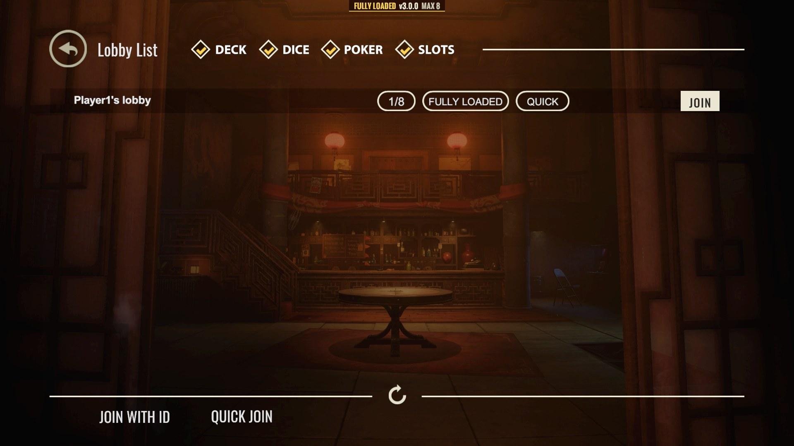

*The lobby list: a FULLY LOADED lobby with its seat count and its house rules. The lobby's name here is a stand-in.*

### Bots for the empty seats

In Liar's Dice (Basic and Traditional), Liar's Deck (Basic, Devil and Deck 2) and the Chaos deck,
the host can fill empty seats with bots: **ADD BOT** and **REMOVE BOT** sit above INVITE in the
lobby, at a table where everybody has the mod. A bot is a real seat at the table on every player's
screen, with a name (Bot Ace, Bot King, Bot Queen and so on) and a character nobody else at the
table plays. It bids, calls liar, throws, bluffs now and then, plays the devil and chaos cards, and
pulls its own trigger.

- **Bots play fair.** A bot knows only what a person in its chair would: its own dice or cards, the
  bids and claims, how many dice or cards each player holds, and what everybody has been shown.
  Nothing about a bot's hidden dice or cards is shown on the host's screen or written to the log
  before the game's own reveal.
- **A bot gives its seat to anybody who joins a full table.** A lobby with bots stays listed, and
  the lobby list and Quick Join count the people at a table, not its bots.
- The host's Kick takes a bot away from any podium. A bot is never picked to take over as host,
  but a host who leaves a table of bots may end its match.
- Liar's Poker, Two-Card Poker and Liar's Slots play without bots for now, and a lobby that
  switches to one of them sends its bots away and says so in the chat.
- Bots live entirely inside the host's own game. Nothing else is started on your PC for them.
- To host without bots, turn off `AllowBots`.

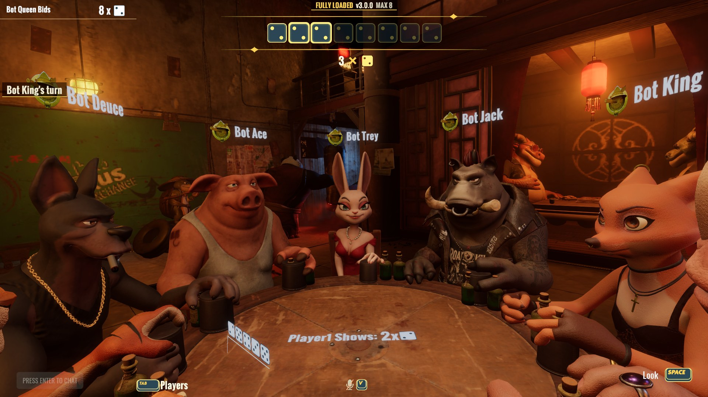

*Bots at a Liar's Dice table, each with its own name and a character nobody else at the table plays.*

### House rules

At a table where everyone has the mod, the host picks **CLASSIC**, **QUICK** or **HARSH** with two
arrows at the top left of the lobby, beside LEAVE. Everyone sees the choice there, with a line
saying what it does at the table picked, and the room is told in the chat. CLASSIC is the game as
it ships, and every new lobby starts on it. Start stays unlit for 5 seconds after a change, so
nobody starts into rules they have not seen.

| Table | QUICK | HARSH |
|---|---|---|
| Liar's Deck, Basic and Devil | 15-second turns, a 4-chamber revolver, 3 cards each | 15-second turns, a 3-chamber revolver |
| Liar's Deck 2 | 15-second turns, a 4-chamber revolver | 15-second turns, a 3-chamber revolver |
| The Chaos deck | 15-second turns, a 4-chamber revolver | a 3-chamber revolver, two chaos cards in every twelve |
| Liar's Dice | 15-second turns, 3 dice each | 3 dice each, one drink and you are out |
| Liar's Poker | 15-second turns, every hand starts on 1 bullet | every hand starts on 1 bullet, no Coward's Fold |
| Liar's Slots | everyone starts each round on 2 points | the dead spin spares about 1 in 7 instead of 2 in 7 |
| Two-Card Poker | always CLASSIC | always CLASSIC |

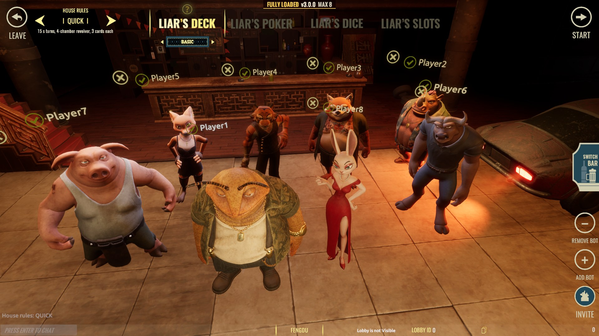

*House rules at the top left of the lobby, here on QUICK, with what it does at the table picked.*

### Two more tables

- **Liar's Deck 2 is back** on the deck arrows: right from Chaos, or left from Basic. Seven cards
  each, and your hand carries over from round to round until no more than one player still has
  cards. Its card, help page and sound are the game's own.
- **Two-Card Poker**, an older bluffing game the game carries but never put on a menu, is on the
  Poker tab's new arrows. Two cards each from a deck of 21, swap or pass, then challenge, call liar
  or show down, and the best hand takes the shotgun. The ? beside the tab opens its rules.
  Everyone plays as Scubby there, the only character the table was made for.
- The Poker tab's plate now reads **LIAR'S POKER**, the mode's real name.

Only the host can choose either table, and only at a table where everyone has the mod.

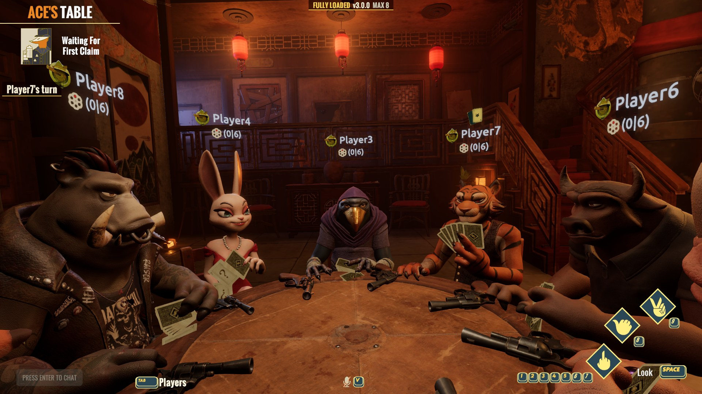

*Liar's Deck 2 at a table of eight: seven cards each.*

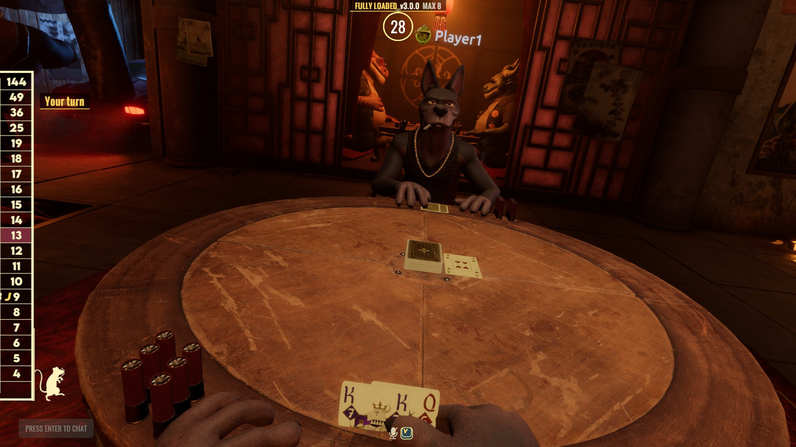

*Two-Card Poker: everyone plays as Scubby here.*

### During a match

- **Hold Tab to see the whole table:** everybody seated, still in or out, and the two numbers that
  matter in that game. Cards in hand and shots survived in Liar's Deck, cards and the chamber in
  the Chaos deck, lives and each player's bid in Liar's Dice, bullets and folds in Liar's Poker.
  Liar's Slots keeps its own leaderboard, which is always on screen.
- **Awards at the end of a match.** The win screen names up to five award winners, such as Best
  Liar, Lie Detector, Nerves of Steel, Luckiest, Sharpshooter, Spot On and Card Shark. Nobody gets
  more than two, nobody who left before the end gets one, and the win screen stays up for 15
  seconds instead of 10 so there is time to read them.
- **Once you are out, A and D walk round the table.** Alongside the game's own spectator views
  there is a camera at every other seat, so you can watch each player in turn. They show only what
  anyone at the table could see: hands, dice, reels and hole cards stay as hidden as they are from
  a chair. Liar's Poker with four players or fewer keeps just the game's own views, and so does
  Two-Card Poker at any size.
- **A line says whose turn it is**, and who you are aiming at.
- **Emotes come back after 10 seconds** instead of the game's 12, at tables where everyone has the
  mod.

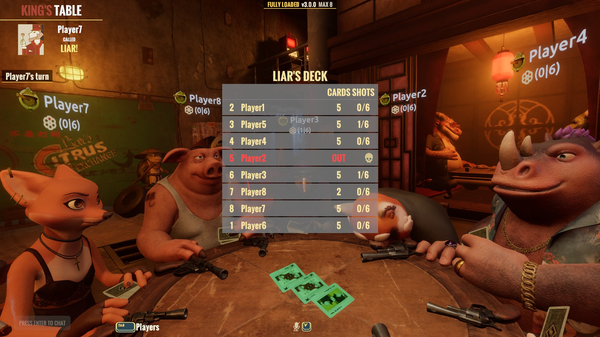

*Holding Tab in Liar's Deck: everyone seated, who is out, and each player's cards and shots.*

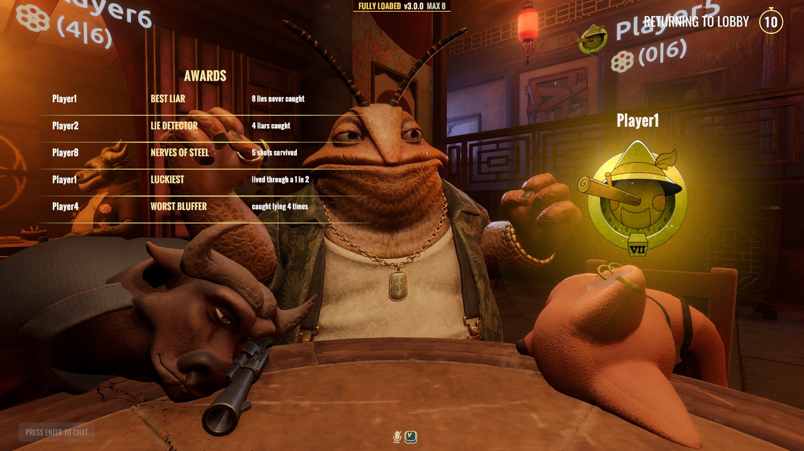

*The win screen with five awards, nobody holding more than two.*

### In the lobby

- **Change outfit.** Two arrows at the top right, under Ready, step your character through the
  wardrobe's outfit sets, and everyone sees the change at once. A controller's D-pad up and down do
  the same.
- **Block a player.** A red cross sits just after every other player's name. Click it twice to
  block them: the first click turns it gold and asks, the second blocks. Their lobbies then vanish
  from your list, the menu's count and Quick Join, and when you host, all they see is Failed To
  Connect. **BLOCKED**, beside QUICK JOIN in the lobby list, lists everyone you have blocked, each
  with UNBLOCK. Only Steam IDs are kept, in `%LOCALAPPDATA%\LiarsBar8P\blocked.txt`. Steam's own
  block list is not used.
- **The host's Kick works on podiums 5 to 8**, and on a bot's podium.
- **Joiners are marked ready** as they arrive and when everyone comes back from a match, so the
  host only has to press Start. Anyone can un-ready with the game's own button.

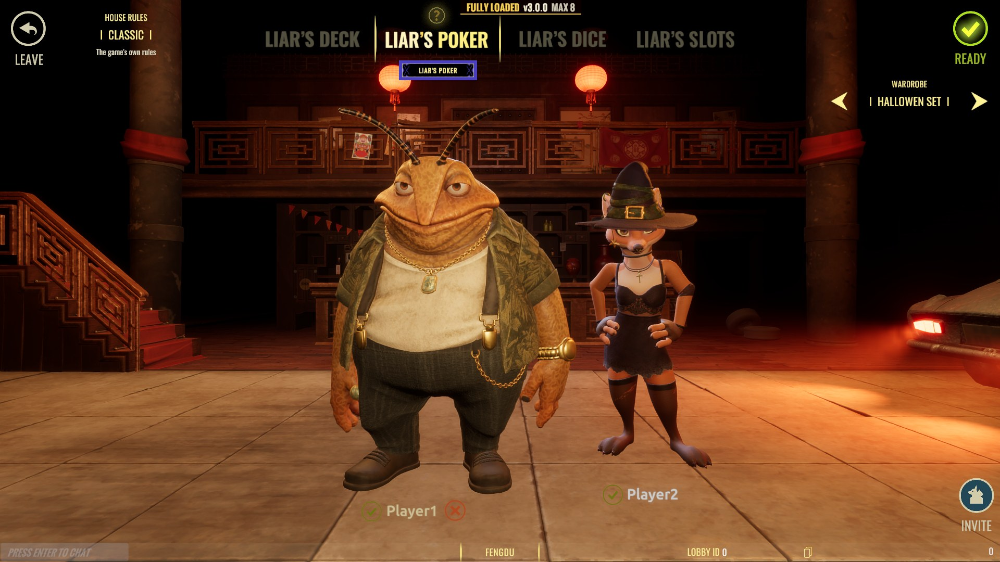

*The outfit arrows under READY, and the red block cross just after another player's name.*

### Fair play

- At a table you host, your game settles every revolver and shotgun pull from its own record,
  counts every Two-Card Poker hand it deals, and removes a player caught cheating. A removed player
  can't come back until you stop hosting.
- At a table where everyone runs this version, Liar's Deck and the Chaos deck send each player only
  their own cards, keep thrown cards face down until the game turns them over, and keep every
  revolver's loaded chamber with the host. No screen there shows the cards in another player's
  hand, the host's own screen included.
- At a table you host, your game checks each player's moves against the rules: only cards that
  player was dealt, no more of them than a throw allows, bids that go up, dice faces that exist,
  and moves made on that player's own turn while they are still in. Anything a slow connection
  could explain is quietly refused, never punished.
- At a table you host, each chat line shows the name of the player who sent it, and names are
  tidied so no two players share one.
- At a table someone else hosts with this version, your game watches for things the rules make
  impossible, such as a player still alive after more pulls than the revolver has chambers, or a
  player who was out coming back. If it sees one, it tells you why, leaves the table and puts that
  host on your BLOCKED list.
- To keep a caught player at your table, turn off `KickCheaters`: your game still settles every
  pull itself and refuses the move.

### Ultrawide screens

At 21:9 and 32:9 the display settings offer your monitor's own shape after the game's sizes, and
the first time the game runs full screen on such a monitor it picks that shape at the height you
already play at, so 1920x1080 becomes 2580x1080 and the black bars are gone. The menus and the
match HUD keep their height, so nothing is cut off. Your own choice in the settings always wins,
and it is kept in `%LOCALAPPDATA%\LiarsBar8P\display.txt`, so updating the mod keeps it.

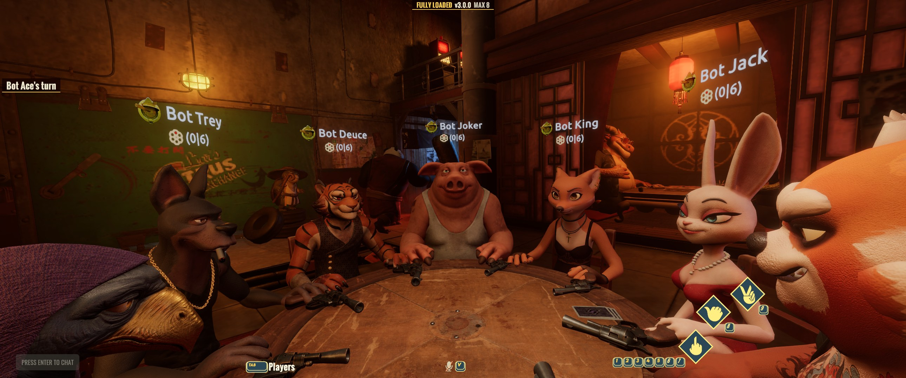

*A Chaos deck table of eight at 2580x1080, the whole width of a 21:9 screen.*

### Languages

The mod's own words follow the language chosen in the game's settings: English, Turkish, Russian
and Simplified Chinese. The translations are machine made, and corrections from native speakers
are very welcome. Anything sent to the whole table's chat stays in English, since everyone there
may read a different language.

### Updates and bug reports

- **The mod updates itself, when you say so.** Each time the game starts it checks for a newer
  version and asks; yes downloads it and restarts the game with it. After an update the main menu
  shows what changed, once.
- **Save Bug Report**, in the settings at the menu and during a match, or F11 anywhere but ranked,
  writes a short, cleaned file to share instead of the whole log (see
  [below](#something-went-wrong-save-a-bug-report)).

---

## Install

Download **`Install-LiarsBar8P.bat`** from the [latest release](../../releases/latest) and run it.

It finds Liar's Bar through Steam automatically, removes any previous copy of the mod, and installs
the current one. It asks for administrator permission because the game lives under `Program Files`.
It is a plain text file: open it in Notepad first if you want to see what it does.

<details>
<summary>Manual install instead</summary>

1. Download `LiarsBar-8P.zip` from the [latest release](../../releases/latest).
2. Extract it somewhere.
3. Run `install.bat` from inside the extracted folder.

Or fully by hand: copy the zip's contents into your Liar's Bar folder so that `winhttp.dll` and
`BepInEx/` sit next to `Liar's Bar.exe`.
</details>

**The first launch after installing is slow**, up to a few minutes while BepInEx prepares the game.
This happens once. Let it reach the main menu. The **FULLY LOADED** tag and the version at the top
of the screen mean it loaded.

### Updating

- **On v1.1.3, v2.0.0 or v3.0.0:** nothing to download. When the game starts, the mod offers the
  update in a window; say yes and it installs it and restarts the game. If you set `Updates` to
  `Off`, run the installer again instead. While Fully Loaded is switched off the mod doesn't look
  for updates, so switch it back on to get them.
- **On v1.1.2 or older:** those versions can't update themselves. Download
  `Install-LiarsBar8P.bat` again from the [latest release](../../releases/latest) and run it.
  **Coming from v1.0.0**, use the new download rather than your old copy: the 1.0.0 installer also
  deleted other mods with "LiarsBar" in their file name.

Everyone at a table needs the same version, so when a new one comes out, the whole group updates.

## Linux and Steam Deck

Liar's Bar has no Linux version: on Linux and the Steam Deck it is the Windows game running through
Proton, and this mod runs through Proton with it. It is the same download, the same files and the
same version number as on Windows.

> **Tested on a Steam Deck** (SteamOS 3.7, Proton 11): installed with `install.sh` from the zip,
> loaded and patched exactly as on Windows, and played an eight-seat table of Liar's Deck. **Not
> yet tested: a Windows player and a Linux player at the same table.** Both run byte for byte the
> same game and the same mod, so they should; if you try it, please say how it went.

1. Download **`Install-LiarsBar8P.sh`** from the [latest release](../../releases/latest).
2. Open a terminal where it downloaded, and run it:

   ```bash
   bash Install-LiarsBar8P.sh
   ```

   It finds Liar's Bar through Steam (the normal client, Flatpak or Snap, any library, SD cards
   included) and installs the newest release exactly as the Windows installer does. It does not
   need `sudo`, and refuses to run with it.
3. **Set the launch option.** In Steam, right-click Liar's Bar, then **Properties, General, Launch
   Options**, and paste in exactly:

   ```
   WINEDLLOVERRIDES="winhttp=n,b" %command%
   ```

   Proton has a `winhttp.dll` of its own and uses it instead of the mod's loader unless told
   otherwise. Without this the game starts exactly as if the mod were not installed: no error, just
   no mod. If the game already has launch options, keep one `%command%`, at the end:
   `WINEDLLOVERRIDES="winhttp=n,b" gamemoderun %command%`.
4. Launch the game. The first launch is slow while BepInEx sets up; let it reach the main menu.

**Steam Deck:** do steps 1 and 2 in Desktop Mode (Steam button, Power, Switch to Desktop). The
terminal is called Konsole, and Steam + X brings up the keyboard. Step 3 also works in Game Mode:
select Liar's Bar, press the cog, then Properties.

**On a Steam Deck, set the game's graphics to High or lower** (Settings, Graphics). On Ultra the
Deck runs out of graphics memory as the table loads and the game hangs on its loading screen, at
four players as well as eight.

<details>
<summary>From the zip instead</summary>

1. Download `LiarsBar-8P.zip` from the [latest release](../../releases/latest) and extract it into
   a folder of its own.
2. Open a terminal in that folder and run `bash install.sh`.
3. Set the launch option, as above.

Or fully by hand: copy `winhttp.dll`, `doorstop_config.ini`, `.doorstop_version`, `BepInEx/` and
`dotnet/` next to `Liar's Bar.exe` (Steam's **Manage, Browse local files** opens that folder), and
set the launch option.
</details>

**If the version never appears in game:**

- Check the launch option is exactly as above: straight quotes, and `%command%` at the end.
- Look in the game folder for `BepInEx/LogOutput.log`. **No file at all** means the loader never
  started, which is the launch option. A file means it did start: save a bug report and send it in.
- If the game hangs on its loading screen when a match starts, lower the graphics (see above). If
  it freezes anywhere else, try another Proton version (Properties, Compatibility), and report it
  either way, saying which versions you tried. Proton 11 is the one tested.

## Settings

`BepInEx/config/liarsbar.eightplayers.cfg`, created on first run. The installer writes it afresh
on every install, so a setting changed by hand does not survive a reinstall; an update from inside
the game replaces only the plugin and keeps it.

| Setting | Default | Meaning |
|---|---|---|
| `FullyLoaded` | `true` | Everything the mod adds. Off, the game plays exactly like the base game, ranked included, and only the **FULLY LOADED** switch on the main menu is left to turn it back on. The switch restarts the game for you; a change made here loads at the next start. |
| `MaxPlayers` | `8` | Lobby size. **Must match across all players.** |
| `AutoReadyJoiners` | `true` | When you host, each player is marked ready as they join and when everyone comes back from a match, so you only have to press Start. They can un-ready with the game's button. Only the host's setting matters. |
| `Updates` | `Ask` | What to do when a newer version of the mod is out, checked each time the game starts. `Ask`: a window asks whether to install it, and yes restarts the game with it. `Automatic`: install it without asking; it loads the next time the game starts. `Off`: never check. |
| `EmoteCooldownSeconds` | `10` | Seconds between your own emotes, at tables where everyone has the mod; the game's own wait is 12 (1 to 60). |
| `ShowUnmoddedLobbies` | `false` | Turn on to put the game's normal lobby list and Quick Join back: you then see lobbies without the mod, and not the ones with it. Lobbies you host stay modded either way. |
| `AllowBots` | `true` | When you host: ADD BOT and REMOVE BOT in the lobby, at the tables bots can play. Turn off to host without them. Only the host's setting matters. |
| `[Fair play] KickCheaters` | `true` | When you host: remove a player whose game sends a move no unchanged game could send, and refuse them at the door until you stop hosting. Off, your game still settles every pull itself and refuses the move, but lets the player stay. Only the host's setting matters. |
| `VerboseDiagnostics` | `true` | Log seat, podium and deck counts. Leave on: it is what makes a bad round diagnosable. |
| `DeveloperMode` | `false` | Test tools for the mod's own testing. Leave off for normal play. At a real table they never change the game for anyone else or show anything hidden: those tools work only in the mod's own loopback test harness. |
| `SelfTest*`, `AutoTest*` | `false` / `0` | Developer only: they appear only with developer mode on, and at a real table they never play anybody's turn but your own. |

A wide display size is not a setting here: it is kept in `%LOCALAPPDATA%\LiarsBar8P\display.txt`,
so a reinstall never loses it.

## What still is not true

Some things only real players on their own PCs can prove, and this project says so instead of
rounding it up. All of the mod's testing runs copies of the game on one PC with one Steam account,
and one Steam account cannot join its own lobby.

- **Eight people on eight machines has never happened.** Every eight-seat table so far has been
  eight copies of the game on one PC. The largest real game was five people on five PCs.
- **Nobody has joined anybody through the lobby list or Quick Join yet.** Each part of finding a
  game that one account can reach has been seen working on real Steam; a join connecting, two people
  ending up at one table, and a friend without the mod being turned away need a second person.
- **The new features have been played on one PC.** Bots, house rules, awards, the Tab board, seat
  cameras, the block list and fair play were all tested with copies of the game talking to each
  other on one machine. A Steam join to a table with bots, a block refusing a real player at the
  door, hidden hands over a real network and a real host migration are still to come.
- **A Windows player and a Linux player at the same table** has not happened.
- **The translations are machine made**, and no native speaker has read them yet.

If you play a game with it, a bug report is genuinely useful, whether it went well or badly.

## Something went wrong? Save a bug report

1. In the game's settings, at the main menu or during a match, press **Save Bug Report**, or press
   **F11** anywhere but ranked. The top of the screen says where the file went: it is in
   `BepInEx\bug-reports` in the game folder (Steam: right-click **Liar's Bar, Manage, Browse local
   files**).
2. Open an issue at
   [github.com/dracbat/liarsbar-8p/issues](https://github.com/dracbat/liarsbar-8p/issues) and attach
   that file.

Tell us three things with it: **how many players**, **which mode**, and **what looked wrong**. The
host's report is the most useful one, but one from any player helps.

The report holds the mod's own recent log lines and a few plain facts: versions, mode, table size,
system and language. Names, Steam and lobby IDs, file paths and anything that looks like a key are
taken out before it is written, and nothing is sent anywhere. The newest five are kept. Please send
that rather than the whole `LogOutput.log`, which also holds the game's own lines.

## Uninstall

Run `uninstall.bat` from the zip (on Linux, `bash uninstall.sh`), or delete `winhttp.dll`,
`doorstop_config.ini`, `.doorstop_version`, `changelog.txt`, and the `BepInEx/` and `dotnet/`
folders.

The uninstaller leaves the folder `%LOCALAPPDATA%\LiarsBar8P`, which holds your block list, your
saved screen size and the mod's logs, so a reinstall keeps them. To remove those as well, delete
that folder by hand: type `%LOCALAPPDATA%` in the Explorer address bar and delete `LiarsBar8P`
(on Linux the same folder is inside the game's Proton prefix).

On Linux, take the `WINEDLLOVERRIDES` launch option out as well. Left in, it does nothing once the
loader is gone. To play without the mod for a while, the **FULLY LOADED** switch on the main menu
is the quicker way, on Windows and Linux alike.

Steam's **Verify integrity of game files** does *not* remove the mod: it checks only the game's own
files, which the mod never changes, and leaves everything above in place.

## Building from source

Requires the .NET SDK and a local install of the game with BepInEx already set up (the project
references the interop assemblies BepInEx generates on first launch).

```
cd src/LiarsBar8P
dotnet build -c Release
```

`package.ps1` produces the distributable zip and refuses to run if any file about to ship carries
the build account's name. `tools/test-linux-installers.sh` tests the Linux installers against fake
Steam layouts, in Git Bash or on Linux. `release.ps1` does the whole release in one command.

## Notes

- `CHANGELOG.md`: what changed in each version, and why
- `STATUS.md`: what has been tested, and what has not
- `NOTES.md`: architecture and class map
- `docs/PLAYER-LIMITS.md`: every hard-coded four in the game, and what was done about it

No game assets or binaries are included in this repository. The only thing the mod contacts is
GitHub, to see whether a newer version is out, and `Updates = Off` stops that. Finding a game goes
through Steam and nothing else.

## Licence

MIT, covering this mod's own source only. Liar's Bar is the property of Curve Animation, and this
mod is not affiliated with it. You must own the game.

The download also carries BepInEx and everything it needs, unmodified: BepInEx and Doorstop under
LGPL-2.1, Il2CppInterop under LGPL-3.0, Dobby under Apache-2.0, a set of MIT libraries, and
Microsoft's .NET runtime. [THIRD-PARTY-NOTICES.txt](THIRD-PARTY-NOTICES.txt) says which file is
which, and the licence texts are in [`licenses/`](licenses/). Both are in the zip.
